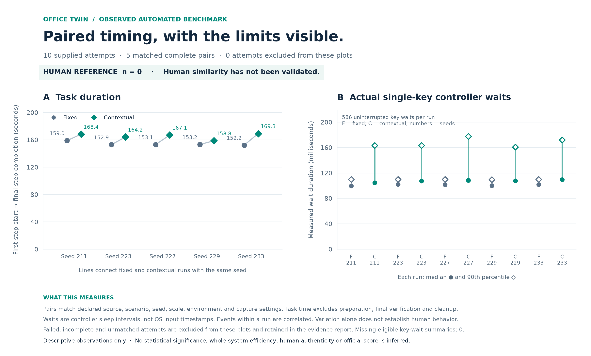

# Office Twin

Office Twin is an NTU × ST Engineering Hackathon project for a synthetic office worker: review local supplier quotes in **Chrome**, compare them in **Google Sheets**, and write a recommendation in **Notepad**. It performs a controlled, repeatable scenario through visible desktop input. It does not navigate or understand arbitrary websites.

**For judges:** start with the [criterion-by-criterion evidence guide](docs/JUDGING_GUIDE.md) for measured results, expected outputs, source links and reproduction steps.

**16 October rundown update:** the new Windows ETW capture resolved **32/32 focus observations** to **three current application identities**, checked against exact Windows creation timestamps and before/after rundown records. The native fixed/contextual pair completed **11/11 steps in both runs**, and **28/28 known process lifecycles** passed; final reported ETW loss counters were **0 / 0 / 0**. See the [rundown evidence and retained failed attempt](docs/process-rundown/README.md).

**All 16 application start records inside the two native trial windows resolve to parent lifetimes:** 10 Chrome → Chrome, two Explorer → Chrome and four Explorer → Notepad relationships. These are observed parent identities, with shared application activity still nonexclusive.

Chrome, Notepad and Explorer stayed open throughout this validation. Their current identities are verified, while the historical parents of the warm main processes remain unresolved because those parents exited before tracing. Newly observed application child relationships are reported only where parent lifetime evidence resolves; application cohorts remain shared and nonexclusive. The [earlier start/stop-only capture](docs/process-events/README.md) retains its own 28/28 canary result, 120-test provenance and historical 0/33 focus bindings.

The current suite passes **172 automated tests**. Across five seeds, the new human-informed mean/median/p90 checks are all within **0.61%** of the supplied targets and closer than the legacy model; see [complete timing evidence](docs/human-timing/README.md). A separate [fresh-environment installation check](docs/reproduction/README.md) reproduced the earlier frozen source with **85 tests** and two successful simulation plans on the same machine. It is not a second-machine native test.

The earlier [resource-sampling fix](docs/resource-sampling-fix/README.md) changed only `office_twin/evidence.py` among runtime modules at its 144-test checkpoint. Its 19/19 noninteractive integration checks remain separately scoped to the unchanged sampler and observer code. The new timing revision changes additional runtime modules; neither update reran the native benchmark. Benchmark and ETW results retain their historical source versions.

The earlier [controlled benchmark](docs/benchmark/README.md) remains **ten normal-speed native runs, 11/11 steps each, and five matched fixed/contextual pairs**. Its separate observer reports actual sampling gaps, parent relationships, scoped CPU/RSS and its own overhead. Both browser and report opening use visible Explorer shortcut double-clicks. The ETW validation pairs are reported separately because their capture conditions differ.

| Observed measure | Fixed | Contextual |
| --- | ---: | ---: |
| Complete native tasks | 5/5 | 5/5 |
| Median task duration | 153.13 s | 167.08 s |
| Task duration range | 152.24–158.99 s | 158.78–169.35 s |
| Full-window controller CPU median | 19.14 CPU-s | 20.61 CPU-s |

Within matched pairs, contextual timing added a median **11.26 s** (range 5.55–17.10 s). Task duration excludes preparation, countdown, final verification and cleanup; CPU covers the full controller window and excludes applications. This is a descriptive comparison of automated policies on one warm, shared host; human similarity remains unvalidated.

**Unassisted human baseline:** the participant confirms a task completed entirely by a human, without guidance, in **720 s (12 minutes)**. The supplied measurements include **42 WPM**, **740 key-down events**, **14 corrected error episodes**, application resources and measured Explorer/Chrome/Notepad ancestry. The [baseline page and machine-readable aggregates](docs/human-baseline/README.md) give every metric, arithmetic checks and measurement scope. These participant-supplied aggregates have no accompanying raw event traces, so they are not used to infer timing similarity or an agent-versus-human speed ratio.

**Earlier guided practice, retained separately:** one participant recorded **734.53 s**, including step-by-step guidance, exact formulas, a sample report and waiting. The saved Sheet's six formulas/results and recommendation were checked after the run; manual operation was participant-reported. See the [historical practice evidence](docs/manual-practice/README.md).

**New optional timing mode:** `--timing human-informed` uses the existing unassisted median **170 ms** and p90 **350 ms** to fit requested pre-key delays. Its implied mean is **199.249 ms**, close to the supplied **200 ms**. Automatic checks compare five seeded samples against those targets and the legacy policy, with no desktop input. This grounds the key-delay model in the supplied data; delivered input intervals, key holds and human similarity remain unverified. See the [fit, results and reproduction commands](docs/human-timing/README.md). The original human record and both legacy timing modes are preserved.



The observer collected 17,018 snapshots at per-run median gaps of about 100.4 ms, with a maximum gap of 510.9 ms and one overrun. For identities created within capture windows, the per-run counts sum to **6 Chrome identities with compatible Explorer parents, 33 Chrome children with compatible Chrome parents, and 8 Notepad identities with compatible Explorer parents**; ten preexisting Notepad observations had unresolved parents. These counts can include reused processes across runs and do not establish complete event coverage. [Parent evidence](docs/benchmark/process-parent-evidence.md) preserves those limits and the [initial series](docs/benchmark-initial/README.md) preserves the six Python-parent observations that motivated the change.

All revised trials passed displayed-sheet and saved-report checks. A [separate final Sheet read](docs/benchmark/saved-sheet-verification.json) confirmed the six formula sources and saved values, with Atlas selected at SGD 600. Historical alternate-scenario validation selected Crest at SGD 525. [Validation history](docs/VALIDATION.md) retains earlier failures and explains the different evidence scopes.

**Submission status:** the human-informed timing update was verified on **16 October 2026 at 22:17 SGT**, with **SUBMITTED — 5/5 steps done**, the new timing-evidence ZIP and matching public story. The [submission record](SUBMISSION.md#human-informed-timing-upload-verified) gives the exact attachment hash and verification scope. Team: **Ajay Asaithambi** (`@ajay007`, leader), **Siddharth Paliwal** (`@siddhartha-paliwal21`) and **Sourabh Sooraj** (`@sourabhsooraj97`). [Devpost entry](https://devpost.com/software/office-twin).

The [revised narrated video](https://youtu.be/oTTT0ECN25U) is 180.13 seconds and preserves the same continuous 162.13-second desktop recording at 1×. Its updated narration and cards report the **16 October evidence: ten native completions, five matched pairs, 85 passing tests and the participant-confirmed 720-second unassisted human baseline**. The footage remains labelled as the **15 October functional version**, before the later Notepad launch and observer changes; it does not depict the later measurements. This edit predates the ETW captures, the 144-test sampler checkpoint and the human-informed timing revision, which are documented separately.

The final presentation review maps evidence to all four judging criteria, adds the scoped CPU/RSS results and the measured process-parent counts, and reconciles the human baseline across the story, repository and chart. Across the ten runs, sampled controller peak RSS was **72.72–73.09 MiB**; controller CPU medians appear above, with observer and application costs reported separately in the [judging guide](docs/JUDGING_GUIDE.md). Source is in the public [GitHub repository](https://github.com/ajayasai/office-twin-ntu-st-2026); raw runs, personal settings and videos are excluded from the source archive. Optional Excel/Word support remains untested because licensed Office is unavailable.

## Run

Use Windows and Python 3.11 or newer. For benchmark, ETW or historical reproduction commands, install [Git for Windows](https://git-scm.com/install/windows) and make a full clone so the tools can record the source commit and access earlier versions:

```powershell
git clone https://github.com/ajayasai/office-twin-ntu-st-2026.git
Set-Location office-twin-ntu-st-2026
```

For the GUI, simulation, single native run or automated tests, you can instead extract `office-twin-source.zip` from the judges' attachment and open a terminal in that extracted folder. The source ZIP has no Git history; use the full clone for the benchmark/ETW harnesses and the frozen historical installation check.

From the source directory, create a virtual environment and install the recorded dependency versions:

```powershell
py -3 -m venv .venv
.\.venv\Scripts\python.exe -m pip install -r requirements.txt -c docs/reproduction/constraints.txt
.\.venv\Scripts\python.exe -m pip check
```

The [constraints](docs/reproduction/constraints.txt) pin the five dependency versions used in the recorded Windows/Python 3.14.2 environment. `py -3` selects your installed Python 3 interpreter; using these pins on another Python version is not a claim that it has been validated. The commands use the virtual environment directly, so activation is unnecessary. Both the full clone and extracted source ZIP include the constraints file.

The dependencies include `pywinauto` and `psutil`. Launch the Tk interface:

```powershell
.\.venv\Scripts\python.exe -m office_twin
```

Run the safe simulation without opening native applications:

```powershell
.\.venv\Scripts\python.exe -m office_twin --mode simulate --workflow sheets --scale 0
```

This replays the 11-step Sheets plan without desktop input. `--scale 0` skips deliberate waits for a quick review; it is not a native timing measurement.

Add `--timing human-informed` to select the aggregate-informed key-delay profile. Verify its scale-1 generated distribution without sleeping or using applications with `.\.venv\Scripts\python.exe tools/verify_human_timing.py --output-dir runs/human-timing-check`. The [timing evidence page](docs/human-timing/README.md) explains targets and limits.

Run the primary desktop scenario on Windows with Chrome already signed in to the dedicated Google Sheet:

```powershell
.\.venv\Scripts\python.exe -m office_twin --mode desktop --workflow sheets --timing contextual --seed 42 --sheet-url "PASTE_DEDICATED_SHEET_EDIT_URL" --output runs
```

For a timing comparison, repeat with a separate output directory:

```powershell
.\.venv\Scripts\python.exe -m office_twin --mode desktop --workflow sheets --timing fixed --seed 42 --sheet-url "PASTE_DEDICATED_SHEET_EDIT_URL" --output runs/fixed
```

Use `--workflow notepad` for the smaller Chrome-and-Notepad task, which needs no spreadsheet account. Use `--workflow office` only on a machine with installed, licensed Excel and Word; that path has not been validated here. See the [Google Sheets setup guide](docs/GOOGLE_SHEETS.md) before a Sheets run.

`runs` is the default output location. Keep contextual and fixed runs separately so evidence is not mixed. Close unrelated documents and first-run dialogs, and use a dedicated test desktop before native testing. Do not test against personal documents or production websites.

## What to demonstrate

1. Read synthetic supplier information on the run's local website in Chrome.
2. Enter the comparison and formulas through Google Sheets' UI, confirm cloud save, and read back the displayed results.
3. Write, save, and reopen a Notepad recommendation consistent with that comparison.
4. Show the actual output files alongside recorded action timing and resource measurements.

Use application state and saved content to determine task success. A log entry saying an action ran is not sufficient proof that it succeeded.

## Evidence and limitations

- **Simulation** exercises orchestration and reporting without performing native office work. Label all its outputs as simulated.
- **Agent logs** are self-reported execution records. They are not independent Windows telemetry.
- **Native evidence** includes the real Google Sheet, its UI readback, the saved text report, a screen recording, and independently collected Windows telemetry where available. Browser-based Sheets activity does not create Excel process evidence.
- **Process events:** the rundown supplement verifies current application identities and the stated canary/controller checks within its measured window. Exited historical parents remain unresolved. Both interrupted attempts and the earlier start/stop capture are retained; process events do not prove input delivery, exclusive task causation or human similarity.
- **Resource measurements** must state their scope. Agent-process CPU/RAM alone excludes Chrome and Notepad, or Excel/Word when using the optional Office path.
- **Human comparisons** require consented manual runs of the same task. Synthetic or automated traces must never be labelled human.
- **Manual reference collector:** `tools/record_manual.py` records explicit task boundaries, optional participant markers and selected-process resources. A browser timer wrapper recorded the [one guided practice](docs/manual-practice/README.md) using duration and collector overhead only; application processes were not sampled. Saved outputs were checked separately. The collector does not verify human participation or collect task input timings. See the [collection guide](docs/MANUAL_BASELINE.md).
- **Timing** is a testable model of pauses and activity, not proof of indistinguishability or a guarantee against automation detection.

If Sysmon is already installed and authorized for the test environment, export the relevant records using the existing configuration. Do not disable security controls, alter logs, manipulate process ancestry, or change security logging settings to improve the result. State when an event type is unavailable under the current configuration.

## Project documents

- [Architecture and AI/dependency provenance](docs/ARCHITECTURE.md)
- [Winning strategy and schedule](STRATEGY.md)
- [Submission checklist](SUBMISSION.md)
- [Paired benchmark and human-baseline protocol](docs/EVALUATION.md)
- [Current rundown identity evidence](docs/process-rundown/README.md), [earlier process-event evidence](docs/process-events/README.md) and [ETW collection protocol](docs/PROCESS_EVENTS.md)
- [Fresh-environment installation evidence](docs/reproduction/README.md)
- [Suggested demo storyboard](docs/DEMO.md)
- [Manual reference collector and guide](docs/MANUAL_BASELINE.md)
- [Unassisted human baseline: measurements, provenance and methods](docs/human-baseline/README.md)
- [Guided manual practice and verified saved outputs](docs/manual-practice/README.md)
- [Manual baseline log template](docs/baseline-template.csv)
- [Devpost project narrative](docs/DEVPOST_ENTRY.md)
- [Narrated pitch script](docs/PITCH.md)
- [Validation details](docs/VALIDATION.md)

## Provenance

This project is being developed with AI assistance. Document the tools used, generated or adapted components, third-party dependencies, and the human review and validation performed. The public event pages do not resolve all policies on AI assistance or pre-existing code; the participating students should confirm these points with the organizers and follow any private briefing they received. Do not claim that unreviewed generated code is original human work or that unperformed tests passed.

The public event requires complete source through a GitHub link, implementation documentation, and a demonstration video. The deadline is **18 October 2026, 00:00 Singapore time**, immediately after Saturday 17 October ends. See the [official overview](https://ntu-x-st-engineering-hackathon.devpost.com/), [rules](https://ntu-x-st-engineering-hackathon.devpost.com/rules), and [schedule](https://ntu-x-st-engineering-hackathon.devpost.com/details/dates).
