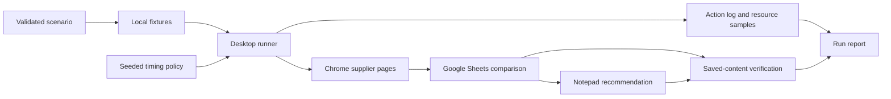

# Architecture and provenance

Office Twin executes one controlled procurement task. A validated scenario supplies three synthetic quotes, quantity and delivery deadline. The agent opens local supplier pages in Chrome, enters a comparison and six formulas in a dedicated Google Sheet, then types and saves a recommendation in Notepad. The alternate scenario demonstrates that a changed quote changes the selected supplier.

## Components

| Module | Responsibility |
| --- | --- |
| `fixtures.py` | Validate input; derive totals, eligibility and the correct recommendation; create isolated synthetic fixture files. |
| `runner.py` | Orchestrate a run; persist results even after failure or cancellation. |
| `desktop.py` / `sheets.py` | Control the documented desktop workflow using pywinauto, window checks and a dedicated Sheet URL/tab binding. |
| `timing.py` | Produce seeded fixed or contextual delays for reading, typing, switching, review and correction. |
| `evidence.py` | Record controller actions and measure controller CPU time/RSS with psutil. |
| `process_trace.py` | Attempt passive Windows process-start observation; report unavailable capture explicitly. |
| `observer.py` / `tools/observe_run.py` | Read process identities, parent metadata and resource counters in a separate process; report sampling gaps, nonexclusive application cohorts and observer overhead. |
| `tools/run_benchmark.py` / `tools/analyze_benchmark.py` | Run counterbalanced fixed/contextual trials, retain failed attempts, check matching conditions and export privacy-filtered measurements. |
| `report.py` / `compare.py` | Produce self-contained HTML reports, preserving failures and differences between configurations. |
| `simulation.py` | Replay the plan without native application actions; label outputs as simulated. |
| `gui.py` / `__main__.py` | Expose the desktop control panel and command-line interface. |
| `tools/record_manual.py` | Collect explicit manual-task boundaries, optional participant markers and selected-process resource snapshots; mark outcomes as participant-reported and unverified. |
| `tools/record_demo.py` / `tools/build_pitch.py` | Record native execution, then add captions, synthetic narration and opening/closing cards while preserving the continuous source run at 1×. |

The runtime reads scenario values from its validated input. Viewing local pages does not constitute autonomous visual extraction or general website understanding. No cloud model call is made during a run. Google tools helped create the fixture and independently inspect saved cells; they are not a shortcut used by the native task runner.

## Control and error handling

Each run has its own local output directory. The Sheets workflow validates the intended spreadsheet and `Quotes` tab, clears the owned comparison range, commits formulas explicitly, waits for saving, reloads, and checks displayed results. It verifies the saved Notepad text separately. Formula source is independently checked outside the runtime.

The desktop must remain unlocked and idle. Window checks and bounded waits reduce targeting errors, but do not establish that every focused child control is correct. Escape or the GUI cancellation control stops a run. Failures preserve their partial evidence and must not be rewritten as successful attempts. The recommendation deliberately includes a corrected typing error; that correction is scripted, not evidence that the model has learned human mistakes.

Contextual timing is reproducible at the policy level through its seed. Application waits and OS scheduling vary. Timing defaults have not been calibrated to human observations. The runtime does not fabricate OS logs, conceal the controller or modify process relationships.

The manual collector performs no desktop automation and captures no task keystrokes, pointer activity, window titles or screen content. It measures explicitly selected application processes separately from its own overhead. Its output cannot establish human participation or correct task completion; those require separate evidence. The 41-test suite includes five collector checks, but no human reference runs have been performed.

## Provenance

Source code, synthetic fixtures, documentation and tests were created and iterated with **OpenAI Codex assistance**. Codex also executed the documented automated and native validation. No student review, manual reference run or organizer approval is implied by those checks; the participating team must record those separately.

Runtime dependencies are declared in `requirements.txt`. The tested environment used pywinauto 0.6.9, psutil 7.2.2 and pywin32 312, with comtypes 1.4.17 as a transitive dependency. Python supplies Tkinter and the standard-library modules. FFmpeg was used externally for the local demonstration recording; Chrome, Google Sheets and Windows Notepad are host applications and are not bundled. Dependency and application licenses remain their respective owners' terms; the source package does not include their binaries.

The final local video, `dist/office-twin-submission.mp4`, is 180.13 seconds: an eight-second introduction, the continuous 162.13-second desktop recording at 1×, and a ten-second closing card. Microsoft Zira Desktop provides synthetic narration, and FFmpeg assembles the edit. The video presents recorded execution, not a live demonstration. Upload and publication status are tracked in [validation](VALIDATION.md).

The separate observer uses Windows Toolhelp for process inventory and psutil for identity/resource counters. It does not read controller action logs or browser content. Its sampled observations are distinct from WMI process-start events and cannot replace an unavailable Sysmon trace. Chrome and Notepad cohorts can include unrelated activity. See [telemetry and benchmark reproduction](TELEMETRY.md) for scope and limitations.

See [validation](VALIDATION.md) for observed outcomes and [evaluation](EVALUATION.md) for the outstanding human comparison.
